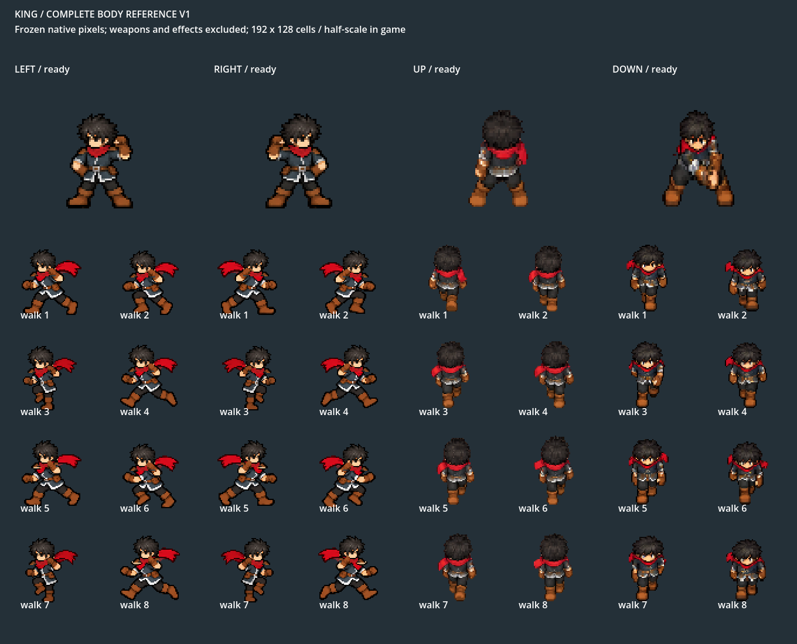

# King complete-body reference v1

2026-10-11. Full-body authority for new weapon standing/walking art. This succeeds the older head/height-only use of `native_identity_v1`; that older folder remains source provenance. The owner-approved Greatsword body is the canonical walking/ready reference. No new character is generated here.

`left|right|up|down_ready.png` are isolated192×128 complete actors with no steel or effects. The board shows all eight approved gait cels in each facing at fixed nearest-neighbor zoom. Do not judge anatomy from weapon-inclusive bounds or change body size to fit a weapon.

Actual immutable PNGs/resources and hashes live in `assets/characters/playable/king/body_library/v1/`. Pose width can change with extended arms/scarf; the whole approved body, not a nominal width/height, governs reuse. For genuinely new attack motion, use this reference plus the accepted full-body action family and require native visual review before a new versioned pose is adopted. Do not transplant the head onto a separately oversized torso and claim identity has been checked.

The reference ready board remains the canonical Greatsword stance, not a requirement that every weapon brace its arms identically. Axe DOWN now reuses the existing complete `down_relaxed` body: neutral0 during ready and folded4–7 during rest. The frozen library PNGs/hashes are unchanged. [Current DOWN comparison](../../../../review/combat/king_down_body_polish_2026_10_11/axe_idle_comparison.png) shows this approved-pose reuse and its stable standing/rest height.

Reproduce the board with `tools/review_king_shared_body_runtime.gd` under native Compatibility rendering. [Required workflow/checks](../../../../../docs/design/king-shared-body-library.md) · [runtime comparison and owner-review status](../../../../review/combat/king_body_consistency_2026_10_11/README.md).
