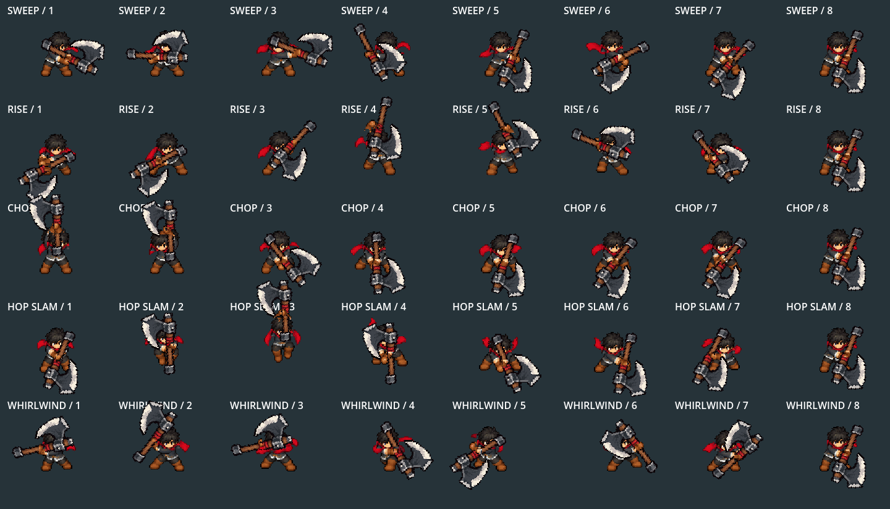
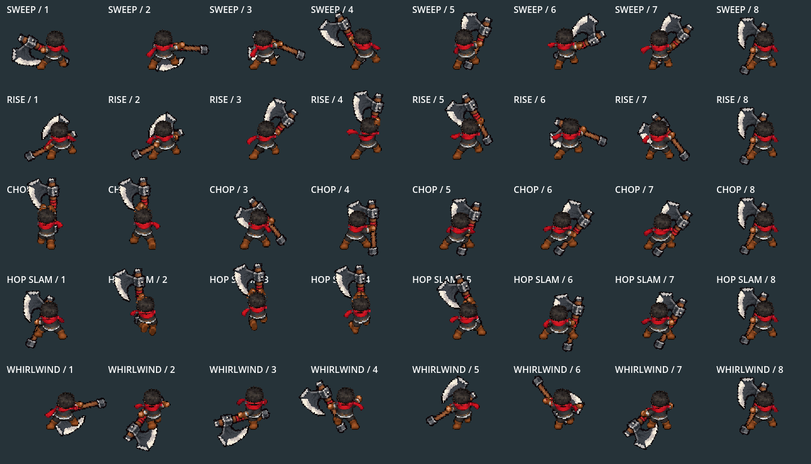

# Iron Beard: native front/back review

2026-10-06. Installed in normal Player/King equipment. Stop/restart F5, use F9 → Tab → Iron Beard Axe → Equip, then F7 Combat Lab. Move with WASD and aim upward/downward for the normal basic attack. The direct `tools/launch_king_axe_training.ps1` launcher uses the real Lab and normal controls, with isolated non-saving storage. Older grip-review launcher is a side-only comparison.

Native Godot4.7.2 Compatibility capture, fixed60fps; the preview samples every second render frame at30fps. The top pair are UP/back and DOWN/front, the middle pair preserve accepted side art, and the bottom shows actual game size plus separate approved native walking. The140-frame GIF is decoded and verified. Its pause at the end is preview metadata, not attack recovery.

The two pose sheets render all80 attack keys using the native presenter and canonical axe. They deliberately exclude white swing effects to expose anatomy/grip placement. The moving actual Player preview above includes the existing effects. Each released cut ends in the same held guard; only the fourth cut has authored hop lift.

`validation.json` and `native.log`: **2340 checks /0 failures**. Real Player/profile selection, all five attacks in four directions, no original-sword vertical fallback, brown glove registration, head proportions and connected glove/head/torso, sole94 after cleanup, travel-driven gait/freeze, physical-back depth and idle stow/retrieval. `motion_timeline.json` records all140 actual captures, combo step, phase and pose. `pose_export.log` records the80 native static pose export. `art_check.log` is the faster448-check pixel/resource pass only; it does not establish gameplay.

`gameplay/` holds the separate real-Lab/Bag/equipment/contact smoke evidence: **114 checks /0 failures**. It verifies normal Tab/equip/pause, five-cut buffers, front-only ordinary contact, rear/front radial contact exactly once, outward knockback, range misses, back stow/draw, gait, swaps, F9 and inventory snapshots. The older test needed a null guard while SceneTree removed the old scene before adding the Lab; the scene transition itself was unchanged. This legacy review harness still reports57 ObjectDB instances at shutdown, despite the gameplay pass. That teardown warning remains open; the new native cardinal proof exits without it.

All42 raster/resource outputs reproduce identically.329 preexisting family/canonical/shared presentation files retain their hashes; only Iron Beard's existing profile adds six cardinal bindings. Damage, contacts, timing, sounds and other weapons are unchanged. Source/reference/prompts/build manifest: `art_source/generated/characters/king/axe_cardinal_2026_10_06/README.md`.

Earlier `body_inspection.png` and `slam_anatomy*.png` are registration diagnostics, not final pose/animation proof. Owner art/motion approval, comparative balance, campaign acquisition and device profiling remain open.
