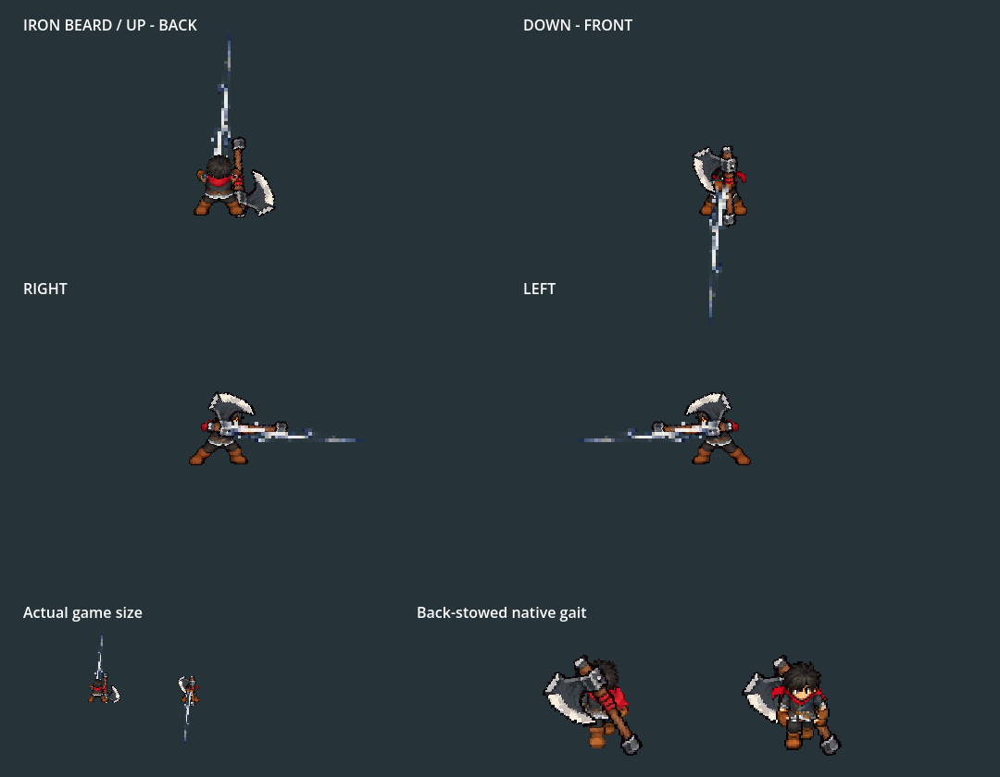

**Rejected/superseded on2026-10-06:** Owner rejected the handle-led jab. This retained source/proof describes that historical edition; current game uses a rising blade cut and complete slashes. See the matching axe_rise_2026_10_06 folder and docs/design/king-axe-cardinal-motion.md.

# Iron Beard: chop, straight jab, hop slam, whirlwind

2026-10-06. Installed in the ordinary Player/equipment profile, Combat Lab and stages. Restart F5 → F9 → Tab → Iron Beard Axe → Equip, then F7. WASD walks, left click uses normal basic attacks, SPACE dodges. `tools/launch_king_axe_training.ps1` opens the actual Lab with the axe equipped, isolated storage and suppressed saving.

Native Godot4.7.2 Compatibility capture, fixed60fps, sampled every second frame at30fps. Top: UP/back and DOWN/front; middle: side/right and mirrored left; bottom: actual game size and separate native gaits. The110-frame GIF is decoded and checked. Final hold is preview timing, not attack recovery. The normal four-cut clock is2.86s; body lift during hop is cosmetic. Contact walking is planted; wind-up/recovery permit25/60% walking. Current identity/carry/gait and the canonical axe are retained.

The same frozen production Player poses are rendered with and without trails. `jab_validation.json` records414/486/519/561 bright effect pixels in enlarged UP/DOWN/RIGHT/LEFT views and a forward-facing shaft dot product over.95. Static pose sheets alone initially missed a reflected-basis rotation error; final clips keep full authored rigid bases and explicit preparation turns. White jab art is registered into its own narrow contact row and real directional lane.

`side_attacks.png`, `up_attacks.png` and `down_attacks.png` render all156 body/axe/glove slots using the native presenter. They omit FX to expose anatomy and grip placement. Keys1–4 wind up,5–7 contact,8–10 released recovery and11–13 queued recovery. Released attacks settle into the same held guard. Queued endpoint13 is inherited by the next opening; late/standalone input preserves the actual rendered entry.

Verified evidence:

- `validation.json`, `native.log`, `motion_timeline.json`: **2086 checks /0 failures**,110 captures. Actual Player four-cut buffers, directional roots, head/glove/torso connectivity, common sole, grip/weapon scale, queue endpoints, forward rendered jab, visible white impact, native travel/freeze and back stow/retrieval. Clean exit.
- `movement_validation.json`, `movement.log`: **195 checks /0 failures**. All four cuts and facings through actual Player physics/input:25% wind-up, zero contact travel,60% recovery, full idle speed, incoming knockback and unscaled dodge. Clean exit.
- `gameplay/validation.json`, `gameplay/native.log`: **110 checks /0 failures**. Actual Tab/Bag/equip/pause, four-cut chains, forward-only opening, narrow jab contacts/misses in all facings, radial rear/front contact once, outward knockback/range, stow/draw/gait, swaps/F9 and inventory snapshots. Off-lane test targets are placed relative to the real elevated weapon pivot, not King's boots.
- `greatsword_regression/native.log`: **158 checks /0 failures**. Greatsword proud idle, body/FX readability, walking/dodge/knockback and switching to the axe's own movement policy. Clean exit.
- `side_review/native.log`: **474 checks /0 failures**. Updated older side review follows current four-cut profile, all16 raster FX keys, radial finisher, actual hop, canonical grips, carry/pause/detach/cancel/reset and unchanged original sword fallback.
- `export.log`:156 native pose slots; `training_launch.log`: actual Lab `AXE_TRAINING_READY`, normal Bag and successful native startup/exit.

The legacy review/gameplay harness retains exit-only leaks:55 ObjectDB instances in the Lab test;2 and one resource in the focused review. The Lab run also logged WASAPI output-device invalidation; subsequent visual/physics checks use Dummy audio while retaining native graphics. No audio-device recovery or audio quality claim is made. Cardinal/movement/Greatsword/direct-training proofs exit cleanly. These tool teardown limits do not constitute owner motion approval or phone profiling.

All37 new raster/resource outputs rebuild identically. Of397 preexisting protected files, only Iron Beard's combo/profile resources intentionally change;395 retained originals/other-family/shared files match. Canonical steel, accepted idle and gait are byte-identical. [Source/prompt/build manifests](../../../generated/characters/king/axe_flow_2026_10_06/README.md), [rules and tuning](../../../../docs/design/king-axe-cardinal-motion.md). Owner feel/visual judgement, measured comparative balance, campaign crafting, authored family skills/reactions and device profiling remain open.
