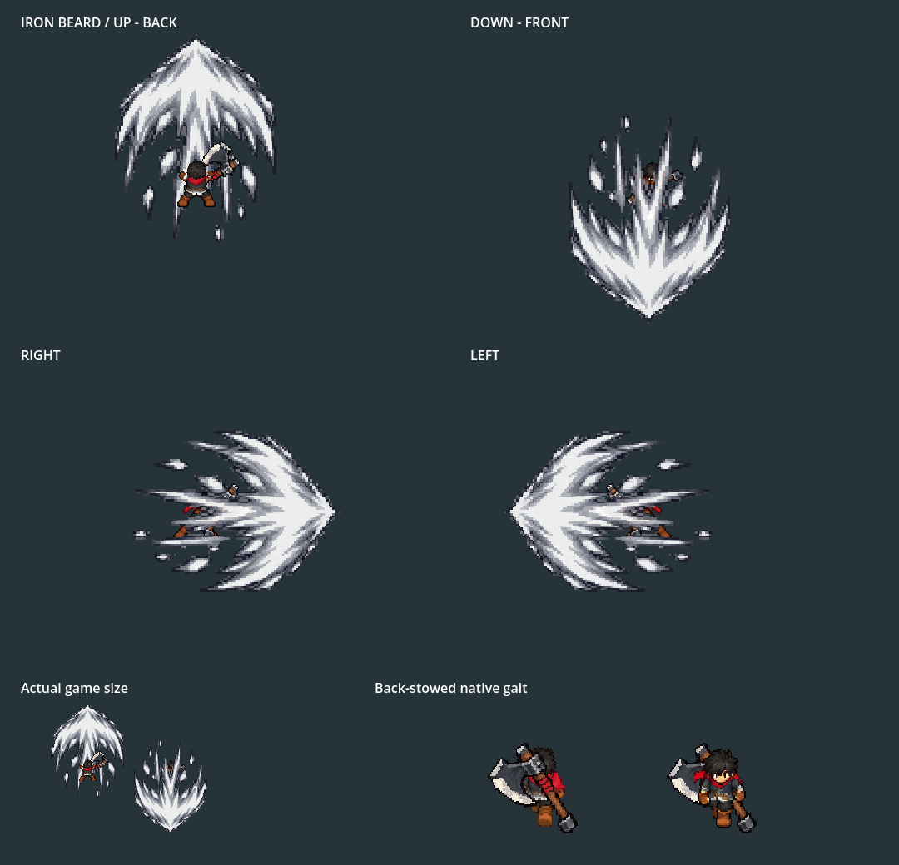
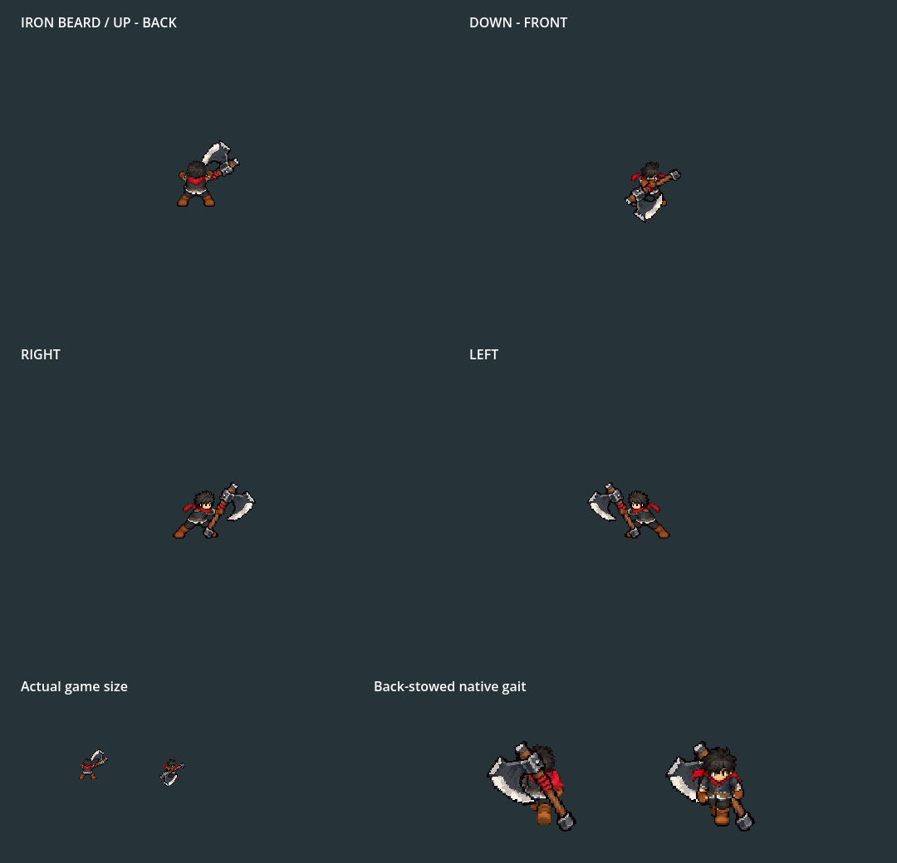

# Iron Beard: third axe-head thrust inside the five-hit combo

2026-10-06. Current normal Player/equipment/Combat Lab/stage profile: **chop → rise → head thrust → hop slam → whirlwind**. The third hit pushes the axe's real cutting head forward, with the handle behind. Stop and restart F5 → F9 → Tab → Iron Beard Axe → Equip, then F7. WASD walks; left click attacks; SPACE dodges. tools/launch_king_axe_training.ps1 opens actual practice with normal controls/Bag and isolated non-saving storage.

Native Godot4.7.2 Compatibility graphics, fixed60fps sampled at30fps. The132-frame GIF is decoded and verified. Top: UP/back and DOWN/front; middle: right and mirrored left; bottom: actual game size and native gaits. Review cells are enlarged to show every forward tip without panel overlap; the final hold is preview timing. Production clock3.52s, with25/0/60% wind-up/contact/recovery walking. King/body/weapon scale, carry/stow and gait remain.

head_thrust_validation.json records an actual rendered cutting-edge forward dot of1.0 in all four directions, and20.45 world pixels between the leading head and trailing butt. The landmark(8,30) is checked against the canonical weapon's pale cutting-edge pixel, rather than an arbitrary crown/face point. Broad white effect area is12147–12588 independently measured bright pixels at2.2x review scale. All four final raster tips end atX115 inside their128px cels; no opaque edge pixels touch any of the twenty cells' borders. slash_padding.json retains the audit. Complete first/fourth slashes remain in complete_slash_0.png / complete_slash_3.png and same-pose fan-crop comparisons.

Current verification:

- validation.json / native.log / motion_timeline.json: **2539 checks,0 failures**,132 captures. Actual Player five-cut buffering, directional roots, head/glove/torso connectivity, common sole, canonical weapon scale, inherited queue endpoints, head-forward grip registration, complete white effects, resolved gait/freeze and back stow/retrieval.
- movement_validation.json / movement.log: **243 checks,0 failures**. All five cuts in all four directions use25/0/60% phase walking/full idle, grounded contact, incoming knockback and unscaled dodge through real Player physics.
- gameplay/validation.json / gameplay/native.log: **138 checks,0 failures**. Actual Tab/Bag/equip/pause, five-cut chains in all directions, first/rising forward contact, third-head contact once and rear/off-axis/distant misses, fifth radial contact once/outward pressure/range, stow/gait, swaps/F9 and snapshots.
- side_review/native.log: **575 checks,0 failures**. Existing review follows five cuts and all20 effect keys, real hop, radial finisher, canonical grips, idle/pause/detach/cancel/reset and original sword fallback.
- export.log:195 actual rendered body/axe/glove pose slots in side_attacks.png, up_attacks.png and down_attacks.png. These anatomy sheets omit FX intentionally.
- training_launch.log: AXE_TRAINING_READY with the equipped axe and visible Bag in actual Combat Lab; clean native startup/exit.

Native cardinal, pose export and direct training exit cleanly. Existing harness teardown diagnostics remain:57 ObjectDB instances in the Lab fixture;4 instances/two resources in movement;6 instances/one resource in focused side review. Tests use Dummy audio with native graphics; sound quality/device recovery and phone profiling are not established here. Technical results do not constitute owner animation/feel approval.

All46 runtime PNG/TRES outputs rebuild identically;328 native/other-family art files and sidecars are unchanged. Original four slash rows remain pixel-identical including alpha, simply moving to their new row indices. Four new built-in imagegen effect cels are ingested through actual transparent gutters, fixed tip registration and one union scale; no new body generation. Previous four-cut runtime/builder/data snapshots are archived. [Source/prompt/rebuild manifests](../../../generated/characters/king/axe_head_thrust_2026_10_06/README.md), [current rules](../../../../docs/design/king-axe-cardinal-motion.md), [four-cut archive](../../../archive/king_axe_four_cut_before_thrust_2026_10_06/README.md). Comparative balance, campaign crafting/acquisition, bespoke family skills/reactions and device profiling remain open.
