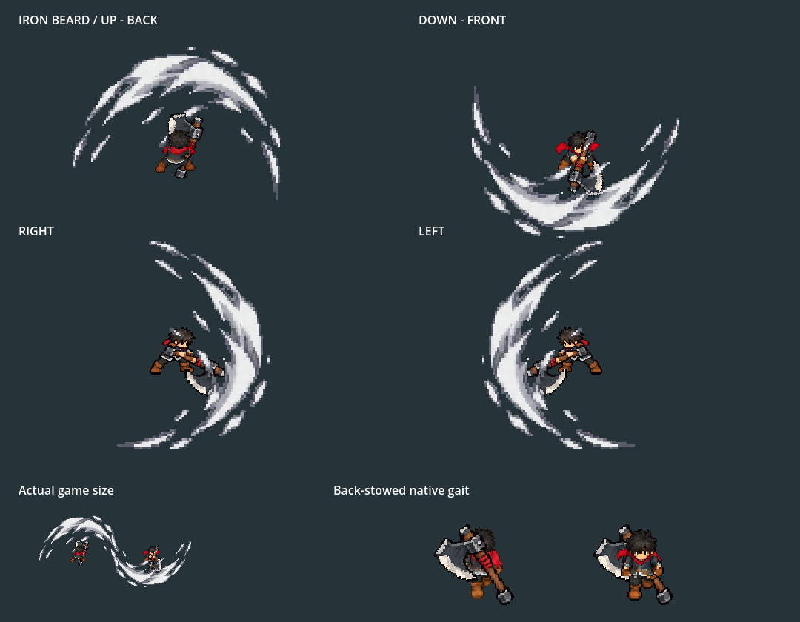
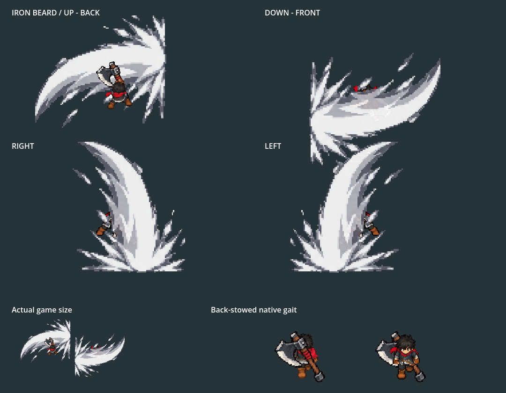

**Superseded on2026-10-06:** The owner clarified that the axe-head thrust must be third, before jump/spin. Current five-hit source/proof lives in axe_head_thrust_2026_10_06. This retained four-cut evidence is historical.

# Iron Beard: chop, rising cut, hop slam, whirlwind

2026-10-06. Current ordinary Player/equipment profile, Combat Lab and stages. The owner rejected the handle-led jab; hit two now uses the original blade-led rising axe cut. Restart F5 → F9 → Tab → Iron Beard Axe → Equip, then F7. WASD walks, left click attacks, SPACE dodges. tools/launch_king_axe_training.ps1 opens the actual Lab with the axe equipped, normal Bag/controls, isolated storage and suppressed autosaving.

Native Godot4.7.2 Compatibility graphics, fixed60fps, sampled at30fps. Top: UP/back and DOWN/front; middle: right and mirrored left; bottom: actual game size and separate native gaits. The110-frame GIF is decoded and checked; its final hold is preview timing. The production four-cut clock is2.94s. Contact remains planted with25% wind-up and60% recovery walking; hop lift is cosmetic. Canonical axe, accepted carry, gait and native source body pixels are retained.

The first/third slashes were hard-cropped to the damage fan. Iron Beard now renders complete padded raster cells with inverse facing/vertical registration at1.1 world pixels per texel. The original effect rows are reused whole; no repaint or extra damage contact is introduced. Other weapon families retain their clipped effects.

The same actual Player pose/source frame is frozen for each full-raster versus fan-crop comparison. cropped_comparison_0.png and cropped_comparison_2.png show the previous clipping method at the same registration. slash_validation_0.json measures1479–2062 restored bright pixels across enlarged views; slash_validation_2.json measures9509–11365. All sixteen source cels preserve their padding; the reported first/third rows have no opaque pixels on their atlas-cell edges.

side_attacks.png, up_attacks.png and down_attacks.png show156 complete native body/axe/glove pose slots. These anatomy sheets exclude FX. Keys1–4 wind up,5–7 contact,8–10 release,11–13 continue. Buffered endpoint13 is inherited by the next opening; standalone/late inputs inherit the actual rendered entry. Releasing returns to the unchanged held idle.

Verified current evidence:

- validation.json / native.log / motion_timeline.json: **2090 checks,0 failures**,110 captures. Actual Player four-cut buffers, all directional roots, native head/glove/torso connectivity, sole/grip/scale, inherited queue endpoints, complete first/third slashes, travel-driven gait/freeze and back stow/retrieval.
- movement_validation.json / movement.log: **195 checks,0 failures**. All cuts/facings through actual Player physics:25% wind-up,0% contact,60% recovery/full idle, incoming knockback and unscaled dodge.
- gameplay/validation.json / gameplay/native.log: **110 checks,0 failures**. Actual Tab/Bag/equip/pause, four-cut chains, forward rising-cut contact and rear/distant misses, radial spin contact once/outward pressure/range, stow/gait, swaps/F9 and snapshots.
- greatsword_regression/native.log: **158 checks,0 failures**. Greatsword body/FX/proud idle, phase movement, knockback/dodge and axe movement policy.
- twinsteel_regression/native.log: **244 checks,0 failures**. Real dual-sword Player/Bag/skills/dash/swaps/Stage I; first-wave and fifth-slash visibility in all directions. Existing clipping remains active.
- side_review/native.log: **491 checks,0 failures**. Older review follows current four moves, complete raster registration/all16 effect keys, actual hop/radial finisher, grips/carry/pause/cancel/reset and original-sword fallback.
- export.log:156 rendered pose slots. training_launch.log verifies AXE_TRAINING_READY with the axe and visible Bag in the real Lab.

Native cardinal, focused side review, pose export and direct training exit cleanly. Existing harness teardown diagnostics remain:57 ObjectDB instances in the Lab fixture;4 instances/two resources in movement and Greatsword;6 instances/two resources in Twinsteel. All runs use Dummy audio for deterministic graphics/physics verification; audio quality and device recovery are not established here. These results are technical verification, not owner motion acceptance or phone profiling.

All37 runtime PNG/TRES outputs rebuild identically;328 original axe/Greatsword/Twinsteel art files and sidecars match protected hashes. No new source generation is used. Fifteen rejected jab runtime/import files and its old builder/data snapshots are archived with .gdignore. [Source/assembly manifests](../../../generated/characters/king/axe_rise_2026_10_06/README.md), [current rules](../../../../docs/design/king-axe-cardinal-motion.md), [rejected jab archive](../../../archive/king_axe_rejected_handle_jab_2026_10_06/README.md). Owner feel, measured balance, campaign crafting, family action art and device profiling remain open.
