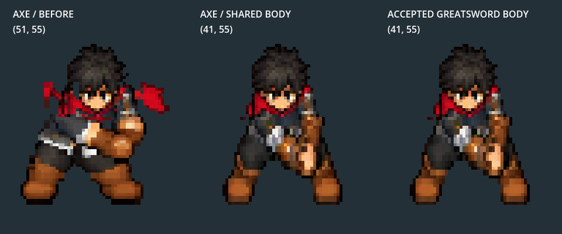
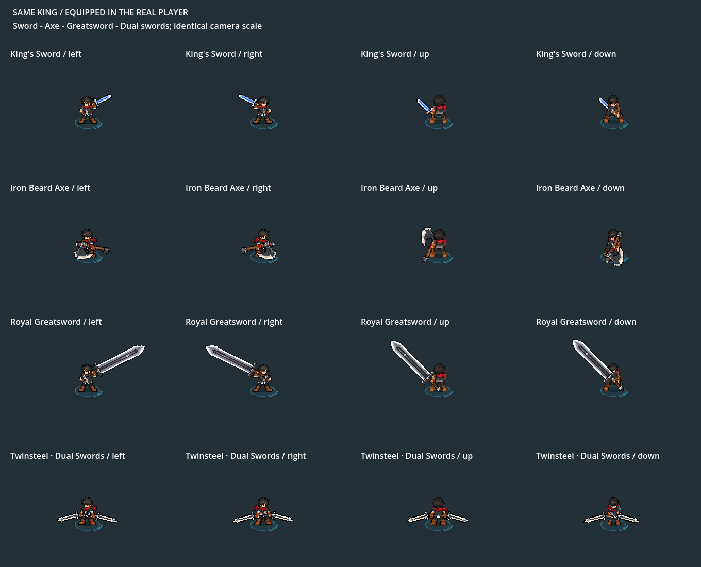

# King body consistency — initial shared-body delivery

**Superseded only for DOWN idle/attacks:** Owner accepts the overall foundation and requests focused axe DOWN idle and axe/dual DOWN attack polish. [Current selected assets, native review and checks](../king_down_body_polish_2026_10_11/README.md). Captures/counts below record the initial delivery; its gait/reference protections remain. The historical body_checks.json summary is recovered from its pre-polish shared_body.log; current results and the initial expectation-failure log are in the new proof folder.

2026-10-11, Decision195. Owner rejected the equipped axe DOWN proportions after the preceding head/height checks. This pass reuses complete accepted bodies instead of generating another torso. Installed in ordinary Player/Bag/Weapons selection; owner visual review remains.

Both old and corrected standing actors are55 source pixels tall. The rejected axe was51px wide; the corrected whole pose is exactly the accepted41px-wide Greatsword body. Extended arms/stance can change bounds, so complete reference pixels, not width/height alone, govern acceptance.

`equipped_walk_0.png` through `equipped_walk_7.png` capture the actual equipped Player with each canonical gait key. Same camera/actor/body scale and origin; weapon extent differs. All four families reuse exact body pixels. [Full body-only four-view source board](../../../reference/characters/king/body_library_v1/turnaround_and_walk.png). `ready_before.png`/`ready_after.png` are larger three-camera galleries; the Sword row includes integrated steel, so its alpha bounds are not an anatomy measurement.

## Verified checks

Godot4.7.2.stable.official.ed1daf0bf, native Compatibility/AMD Radeon rendering. Results refer to the named current logs/JSONs, not process exit alone.

| Check | Result | Evidence |
|---|---:|---|
| Exact shared gait/body references, Sword body/mirror/cadence, immutable hashes, preserved actions and axe endpoints |864 checks /0 failures |body_checks.json, shared_body.log |
| Actual four-facing equipped Player scale/origin, canonical outline and eight gait captures |62 /0 |runtime_body_checks.json, runtime_body.log |
| Axe native full chain, canonical grip/connected vertical anatomy, travel, recovery, rest retrieval and camera effects |2858 /0;132 captured frames |axe_native/validation.json, axe_native.log |
| Axe actual Lab/Tab Bag/equips/contact/reach/travel/rest |138 /0 |axe_practice/validation.json, axe_practice_recheck.log |
| Twinsteel actual Lab/Bag/equips/contact and slash rendering |244 /0 |dual_practice/validation.json, dual_practice.log |
| Twinsteel four-facing proud idle/slow glance/retrieval/travel/swap |100 /0 |dual_idle/idle_checks.json, dual_idle_realtime.log |
| All four weapon roles/contact/damage/phase budgets/Bag readouts |301 /0 |weapons/validation.json, weapons.log |
| Deterministic rebuild |103 PNG/TRES/contract/profile outputs identical |rebuild_checks.json, rebuild_manifest.json |
| New PNG imports |66 valid; no missing source |import_settings.json |
| Original protected files |907 backed up;904 unchanged |protected_files.json; pre-change manifest |

The three changed files within the907-file protected snapshot are Player's SpriteFrames selection and the two stock family presentation profiles. Every original King PNG/TRES/import and the Greatsword family profile remains unchanged. New bodies/resources are siblings. Other scoped edits are the Sword animation material selection, Bag frames selection, verification tools/tests and affected docs.

The candidate CLI accepted the canonical `down_run` atlas and rejected a deliberately altered single torso-area pixel with unchanged height (exit1). `body_gate_positive.log`/`body_gate_negative.log` record this reuse gate; the red-pixel PNG is a deliberately rejected fixture, never a game asset. The immutable library contains ten complete body atlases with frozen SHA256s.

## Validation limits and corrected test attempts

The first axe practice assertion compared movement against an obsolete hardcoded review resource. It now compares against the selected live family gait and passes; travel/pose-change conditions remain intact. The initial dual idle invocation used `--fixed-fps60` with a wall-clock watchdog; the slow native renderer advanced less simulation time than wall time, causing false timing assertions. The existing real-time fixture passes without `--fixed-fps`; game idle timings were not changed. Earlier attempt logs remain for traceability.

Current axe practice exits with its existing57 ObjectDB warning. Dual gameplay exits with2 ObjectDB instances and1 resource diagnostic. Native body/axe views, real-time idle and weapon role verification exit cleanly. These checks are not owner appearance approval, horde profiling, or a phone-performance result.

This correction does not regenerate historical Sword/skill action art or every existing weapon attack. Axe contact/queue cels remain exact except specified ready entry/released endpoints. New motion needs complete-body native review and a separate reviewed pose version. Do not claim arbitrary generated anatomy is accepted merely because head height or these current stock tests pass.

## Rebuild and test

See [the mandatory workflow and commands](../../../../docs/design/king-shared-body-library.md). Offline builder: `tools/build_king_shared_bodies.gd`; immutable/candidate gate: `tools/check_king_body.gd`; stock gate: `tests/king_shared_body_smoke.gd`; actual gallery/reference: `tools/review_king_shared_body_runtime.gd`. Native axe captures use `tests/king_axe_cardinal_smoke.gd -- --output=res://art_source/review/combat/king_body_consistency_2026_10_11/axe_native`. Real-time idle omits `--fixed-fps`.

Backup: `art_source/archive/king_body_consistency_before_2026_10_11/`,907 verified file hashes. It protects original King textures/resources/imports, stock family profiles, Player scene and prior builders/registrar; it is not a full project/save backup. Historical profiles reference immutable original assets. Never restore or rerun old selections over stock without the final shared-body layer.

Restart F5 → F9 → F7 → Weapons → Iron Beard Axe, King's Sword, Royal Greatsword or Twinsteel. WASD/held LMB/Space/Tab Bag/Escape remain. The actual non-saving axe launcher starts with Iron Beard equipped and a paused enemy. Owner comparison of all four facings is next; Iron Reaper stays deferred.
