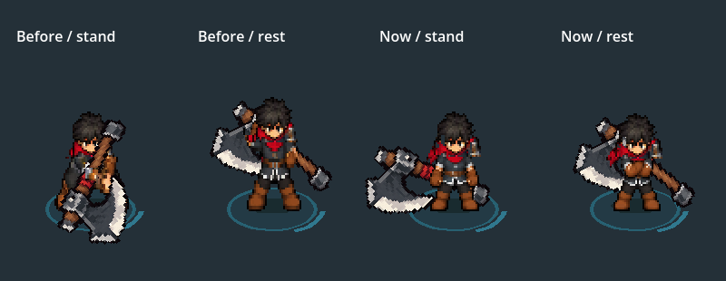

# King DOWN idle and attack polish

2026-10-11, Decision195 follow-up. Owner accepts most of the shared-body implementation and asks only for axe DOWN idle plus axe/dual DOWN attack coordination. This is installed through normal equipment, Player and Bag. Focused owner appearance review remains; Iron Reaper stays deferred.



The prior axe DOWN ready borrowed the Greatsword's braced pose, then rose into an upright rest with its crown8 source pixels higher. The current ready repeats complete relaxed body0; rest uses existing complete folded poses4–7. The face, waist and boots are readable, with a genuine palm holding the axe outside the waist. The shaft paints behind the body. Standing/rest density does not change, and the frozen body library is untouched.

Existing DOWN cuts pinned their crown/collar almost horizontally while the lower torso swung beneath it. Offline whole-cel registration now shares that lateral movement: body, scarf/head, hand mask and both blade grips move together around reviewed lower-torso landmarks. Offsets are explicit and bounded to8 source pixels/4 world pixels. No anatomy pixels are redrawn, stretched or separately counter-moved. Sole94, lift, palette, choreography and phase clocks stay. Natural crouching/turning extents remain; this is a registration correction, not a newly generated attack design.

After registration, exact ready/queued/released body/mask/grip endpoints are copied. Head rectangles are copied without an additional offset relative to the first cel. Axe uses the selected shared DOWN clips; Twinsteel now selects sibling `shared_bodies/dual/down/{diagonal,return,rising_cross,hop_spin,cross_finish}.tres`. All other views, walking bodies, Greatsword files, steel, effects and combat/save rules remain.

`axe_before.png` / `axe_after.png` and `dual_before.png` / `dual_after.png` show actual equipped Player poses at the same camera scale. `axe_idle_before.png` / `axe_idle_after.png` cover all eight standing/rest keys. The compact comparison reconstructs the old complete body/mask from the scoped snapshot, not the current mutable output paths. Native axe motion frames include real contact slashes and all directions.

## Verified results

Godot4.7.2.stable.official.ed1daf0bf, native Compatibility/AMD Radeon. Read JSON/log outcomes, not process exit alone.

| Check | Result | Evidence |
|---|---:|---|
| Complete DOWN body/mask/source equality, head/near/far grip offsets, exact queue/release, fixed soles/phases and preserved other assets |2373 /0;1041 protected files |down_body_checks.json, down_body.log |
| Canonical gaits, frozen library, source-preserving registered axe cuts, Sword body/mirror/actions and ready recovery |864 /0 |body_checks.json, shared_body.log |
| Actual equipped native before/after views and archived idle comparison |84 /0 |native_after.log, PNGs |
| Actual Player axe five-hit chain, directional effects, full slashes, travel/recovery/rest/retrieval |2858 /0;132 motion captures |axe_native/validation.json, axe_native.log |
| Actual axe Lab/Tab Bag/equips/contacts/reach and movement |138 /0 |axe_practice/validation.json, axe_practice.log |
| Actual Twinsteel Lab/Bag/equips, four-facing chain, contact/skills/Stage I and first/final slashes |244 /0 |dual_practice/validation.json, dual_practice.log |
| Deterministic final rebuild |119 outputs identical; exit0 |rebuild_checks.json, rebuild_manifest.json, build.log |
| Current shared PNG imports |58 valid;0 missing sources/imports |import_settings.json, import_final.log |
| Pre-polish snapshot |1076 archive copies hash-verified |snapshot_checks.json |

`rebuild_checks.json` records the final deterministic output comparison; `import_settings.json` records all current shared PNG import settings. Immutable library validation is recorded in `body_library.log`. The stock and DOWN tests check full pixels/attachments; they do not establish owner feel or performance. The axe practice fixture retains57 ObjectDB instances at exit. Twinsteel's current fixture exits with4 ObjectDB instances/2 resource diagnostics. Native pose/axe checks exit cleanly. No cold, horde or phone performance claim is made.

The axe motion fixture uses `--fixed-fps60` to sample its brief contact keys. Its30fps attempt skipped a required contact key and produced a transient travel assertion; no production timing/movement change was made to satisfy that run. Wall-clock proud-idle fixtures must omit fixed FPS. The initial stock equality gate still expected unregistered DOWN cels; its56 expectation failures are retained in `shared_body_initial.log/.json`. Current gates verify exact complete translated source pixels, not relaxed height-only limits. The previous shared-body proof's JSON summary was recovered from its recorded pre-polish pass log after that initial default-output invocation; current results are isolated here.

## Rebuild and play

Run the console from the project root:

```powershell
& 'D:/WORK_APP/godot/Godot_v4.7-stable_win64_console.exe' --headless --path . --script res://tools/build_king_shared_bodies.gd --quit-after 2
& 'D:/WORK_APP/godot/Godot_v4.7-stable_win64_console.exe' --headless --editor --path . --import --quit
& 'D:/WORK_APP/godot/Godot_v4.7-stable_win64_console.exe' --headless --path . --script res://tools/check_king_body.gd --quit-after 2
& 'D:/WORK_APP/godot/Godot_v4.7-stable_win64_console.exe' --headless --path . --script res://tests/king_shared_body_smoke.gd --quit-after 2 -- --output=res://art_source/review/combat/king_down_body_polish_2026_10_11
& 'D:/WORK_APP/godot/Godot_v4.7-stable_win64_console.exe' --headless --path . --script res://tests/king_down_body_polish_smoke.gd --quit-after 2
```

The builder owns final selection and applies `tools/king_down_body_registration.gd` after immutable original contact ingestion. Rebuilds do not reapply offsets to current shared outputs. Unchanged selector files are left alone; changed selectors use temporary-file replacement and explicit error reporting. `tools/review_king_down_body.gd` renders the real equipped Player; pass `-- --after` for the selected result/comparison. It is a development review utility, not export gameplay.

Restart F5 → F9 → F7 → Weapons → Iron Beard Axe or Twinsteel. Tap S to face down; hold left click for the whole combo, release to see exact ready recovery, and wait four seconds for rest. WASD, Space dodge, Tab Bag and Escape retain their controls. `tools/launch_king_axe_training.ps1` starts the actual Lab with axe equipped, all test weapons owned, paused enemy AI and isolated non-saving storage. Use the Weapons tab to swap to Twinsteel.

Scoped pre-polish snapshot: `art_source/archive/king_down_body_before_2026_10_11/`,1076 files with hashes. It is not a full project/save backup. Archived profiles/resources retain absolute runtime dependency paths; original unchanged contact sources are the anatomy comparison authority, while snapshot PNG bytes supply the old idle review. Preserve accepted other views and frozen body-library hashes. No commits or pushes.
