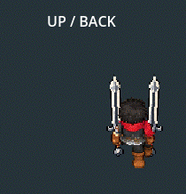
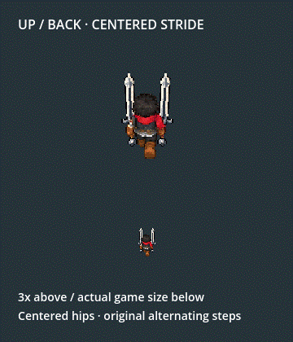
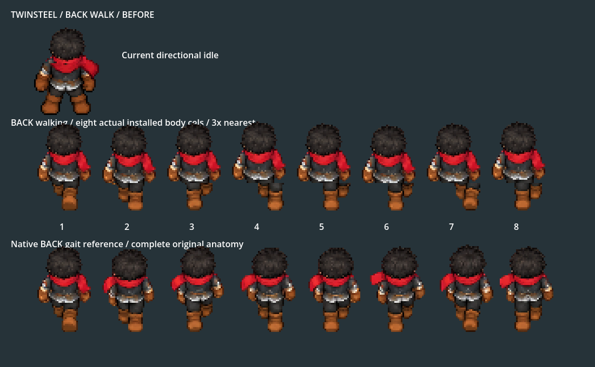
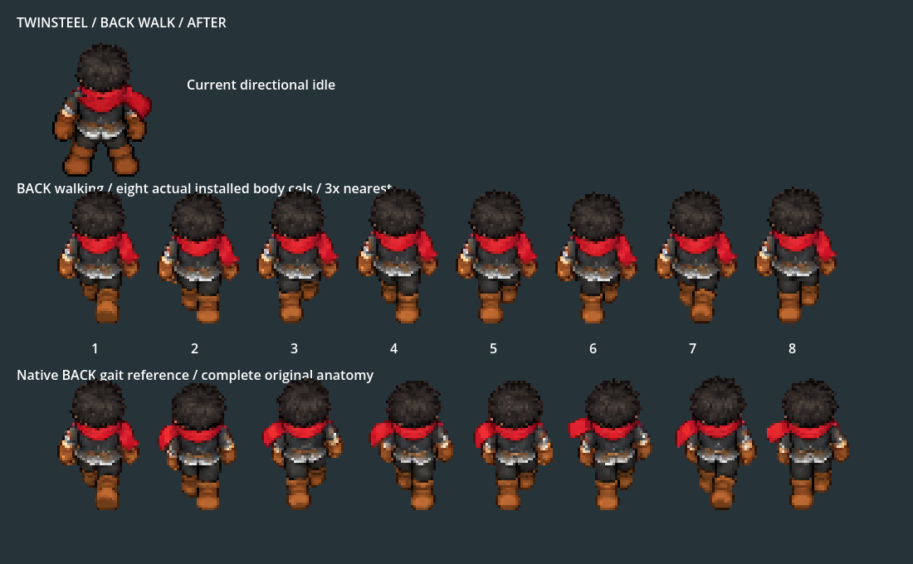

# Twinsteel upward feet beneath the torso

2026-10-06. Owner screenshot identifies UP/back walking feet. The previous DOWN head correction remains installed. UP held its first upper-body cel steady, but copied the pelvis/legs from later complete source gait cels whose root sways horizontally. The pelvis moved fromX96 toX103.75 while the torso stayed fixed.

The offline builder now translates each complete lower-body stride beneath the first pelvis center, measured atY78/Y79 below seamY77. Integer shifts are0/0/-3/-6/-7/-6/-8/-5. The original alternating steps, knees, boot silhouettes and colours remain; upper body/bob, gloves, blades and metadata remain unchanged. Both pelvis rows stay within0.5logical pixel of the torso center. No runtime correction, rescaling, shearing, frozen legs or new art generation is introduced.

## Owner report and corrected motion









## Verification

| Check | Result |
| --- | --- |
| Cardinal pose/presenter checks |4398 checks,0 failures; `motion/validation.json` |
| Actual Player/Bag/combo/skills/dash/reactions/Stage I |210 checks,0 failures; `gameplay/validation.json` |
| Pixel/output scope |Only `up/run_body.png` changes;64 other PNG/TRES files identical |
| Protected heavy/source files |92 identical hashes |
| Repeat build |65 identical outputs; `rebuild_validation.json` |
| Native walking GIF |48 decoded/verified frames |

New assertions check the pelvis on both rows against the fixed torso center and check ankle pixels remain within the aligned leg lanes on every UP key. Existing assertions preserve upper anatomy, coherent bob/grips, original other facings and combat continuity. Before/after row measurements are in `before_registration.json`, `after_registration.json` and `pelvis_validation.json`; hashes are recorded independently. Native Compatibility rendering uses Godot4.7.2; final build/import/native logs are clean.

## Try in game

Stop the existing run and restart F5 → F9 → Tab → Twinsteel · Dual Swords → Equip. Walk upward with W. F7 enters actual Combat Lab after F9. The old downward repair, all attacks, gameplay reach/damage and other facings remain unchanged.

```powershell
& 'D:\WORK_APP\godot\Godot_v4.7-stable_win64_console.exe' --path . --rendering-method gl_compatibility --fixed-fps 60 --script res://tests/king_dual_twinsteel_cardinal_smoke.gd -- --output=res://art_source/review/combat/king_dual_back_feet_2026_10_06/motion/
& 'D:\WORK_APP\godot\Godot_v4.7-stable_win64_console.exe' --path . --rendering-method gl_compatibility --fixed-fps 60 --script res://tests/king_twinsteel_gameplay_smoke.gd -- --output=res://art_source/review/combat/king_dual_back_feet_2026_10_06/gameplay/
```

Run native tests sequentially. Shared builder/provenance remains under `art_source/generated/characters/king/dual_unified_2026_10_05/`; no new generated source is required. Owner visual judgement remains open; these checks establish registered anatomy and the stated gameplay paths, rather than final feel/balance/device approval.
