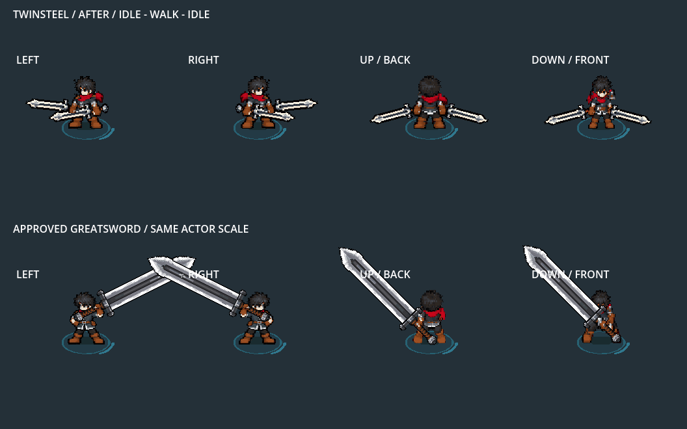

# Twinsteel complete carry remodel — 2026-10-12

Owner rejected the grip-only walking preview and authorized a remodel of walking/idle to address missing/cut frames and wobble. Native idle→walk→idle beside accepted Greatsword exposed a deeper mismatch: different whole upper poses at movement entry and vertical swords dropping much lower than their ready position. Correct palm tracks alone did not resolve this.

## Moving preview

[Before motion](before_motion.gif) uses the preserved prior idle/gait profile. Both recordings render actual equipped Players at the same3× review zoom, without changing the family's normal0.5 scale. All four views show ready, four stride cycles, then ready. Each GIF contains62 decoded native captures at15 nominal FPS, including the last frame; this is travel-driven presenter playback rather than a generative GIF. `before/` and `after/` hold original screenshots and capture validation.

## Installed result and provenance

Stock Twinsteel selects `shared_bodies/dual_carry_v3` in normal equipment, Bag and Lab. Each complete run cel keeps the entire approved upper carry unchanged through row80: native head/neck/scarf/chest/arms/closed hands/waist. SIDE uses canonical Greatsword leg pixels registered beneath it. UP/DOWN use newly generated lower legs at one nearest-neighbor density per view, native palette and fixed sole bounds; the opposite half-cycle mirrors the lower legs to exchange the stepping foot. No frozen body-library PNG, original body resource, actor scale or runtime pose rig is modified.

Ready and walking blades share real palm coordinates, angles and painter order. Side far handle stays hidden. New closed-fist masks include native cuff outlines. Vertical sword tips stay above the soles. The existing planted/folded/slow-glance idle remains pixel/metadata exact. Existing attack body/mask/palm data stay exact except matching normal ready entry, released recovery and final closing carry endpoints. All attack-contact art, effects, timing/authority, other weapons, sounds, controls and saves remain unchanged.

[Source image, generation brief and registration](../../../generated/characters/king/dual_carry_gait_2026_10_12/README.md), [Decision196](../../../../docs/decisions/196-steady-twinsteel-carry-with-frozen-upper-anatomy.md), [body contract](../../../../docs/design/king-shared-body-library.md). The scoped14-file pre-remodel snapshot is `art_source/archive/king_dual_carry_before_2026_10_12`; its copied hashes were verified before edits. Earlier1097-file snapshot remains independent protected history.

## Verification

All scripts used the installed Godot4.7.2 console. Native graphics use Compatibility/AMD; headless source gates do not substitute for native rendering.

| Gate | Result | Scope |
|---|---:|---|
| `king_dual_steady_carry_smoke.gd` |2378/0| Exact complete native upper carry/ready/rest, connected head/waist/feet, distinct alternating lower steps, uniform density, margins/soles and protected attack sources |
| `king_dual_gait_smoke.gd` |2091/0| Real movement input in LEFT/RIGHT/UP/DOWN, all eight keys, mirrored density, true palms/masks/depth, actual wall blocking and run→attack/idle continuity |
| `king_shared_body_smoke.gd` |885/0| Immutable library, exact other-family canonical bodies, Twinsteel complete upper identity/connectivity, Sword pixels/mirror/action preservation and axe endpoints |
| `king_twinsteel_gameplay_smoke.gd` |244/0| Actual Player/equipment/Bag/five-cut contacts and visible first/final raster effects in all directions, skills and StageI |
| `king_dual_v2_idle_smoke.gd` |100/0| Wall-clock ready/plant/fold/glance timing, real rest retrieval and delayed-loop cancellation in four facings |
| Moving native capture |70/0 each|62 captures each, actual equipped before/after presenter and unchanged Greatsword |
| Frozen reference gate |10 atlases unchanged| Immutable complete body-library SHA256s |
| `preservation_checks.json` |1095/0 changes| Every protected original King asset unchanged;39 new PNG imports lossless, no mipmaps, no alpha-border expansion |
| `rebuild_checks.json` |100/0 changes| Every new runtime asset/import and selector rebuilds byte-identically |

Logs/JSONs in this folder record the exact runs. Editor import and `git diff --check` pass. Current native combat/gait/idle runs report no shutdown warnings. This is correctness and presentation evidence, not a phone/stress performance benchmark. Owner motion judgement is still pending; a deliberately steady upper carry may feel calmer than an arm-swinging run. Do not describe the new motion as visually approved.

## Test and reproduce

Restart F5 → F9 → F7 → Weapons → Twinsteel, or run `tools/launch_king_twinsteel_training.ps1` for the actual isolated non-saving Lab already equipped. WASD, held LMB, Space dodge, Tab Bag and Escape retain existing behavior. The already-running F5 game keeps its old loaded assets until restarted.

Rebuild `tools/build_king_shared_bodies.gd` headless, import with headless editor, then run the above gates. `review_king_dual_locomotion.gd -- --label=before` or `--label=after` renders motion; `tools/encode_native_review_gif.ps1 -FramesPath <capture folder> -OutputPath <new GIF> -Fps 15 -Every 1` encodes and checks frame count/last-frame decoding. Use real-clock native idle without `--fixed-fps`; gameplay/gait capture uses `--fixed-fps 60`. Old `dual_gait_v2` roots and palm-track helper stay rollback provenance; the current builder does not regenerate or select them. No commits/pushes or scythe work.
