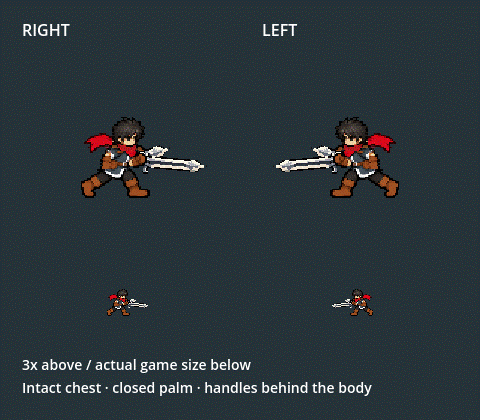

# Twinsteel chest and closed-palm correction

**Historical geometry, owner rejected:** The subsequent yellow sketch places the front sword in the lower near hand, and the owner identifies merged pixels/weak edges. The raised-hand assignment described below is superseded by [the sketch/outline correction](../king_dual_sketch_carry_2026_10_06/README.md). These earlier technical passes are retained as evidence, not art approval.

2026-10-06. The owner identifies the chest/visible hilt after the preceding face and rear-handle correction. The old near forearm rotation selected part of the vest, clipped the lowered fist at the Y77 leg seam, and registered the sword near its wrist. The shaft also drew in front of the chest. A brown pixel at the grip and a short guard-to-origin distance did not prove a complete gripping palm.

The unified offline builder now restores native chest pixels and copies the complete native near forearm/closed fist without rotation, translated3 logical pixels toward the body. The actual palm is source(113,71) -> carry(110,71). Far palm(87,75) remains. Both carried shafts paint behind the connected body, letting the vest and fists occlude handles while the projecting blades stay visible. Side-run foreground masks are empty. Rear angle-16 and near+5 keep the two blades readable after the palm correction.

The approved face, hidden far handle,16x62 blade sizes, all eight native leg keys, common upper/grip bob, UP/DOWN, idle, attacks and silver effects remain. Attack entry inherits the actual body/mask/textures/offsets/depth and restores the destination attack presentation afterward. No new combat logic or runtime correction is added.

[Grip close-up comparison](grip_comparison.png), [before native view](before.png), [after native view](gait/motion_frames/frame_000.png), [owner report](owner_report.png), [before body/source/mask inspection](inspection.png). Native Compatibility rendering on Godot4.7.2 supplies the48-frame motion, with3x above and actual0.5 scale below.

Validation:

- Native cardinal4454 checks/0 failures, including exact native central-chest and complete-palm comparisons, coherent eight-key bob, genuine source legs, both shafts behind the body, empty carry masks, preserved face/blade landmarks and existing all-direction attacks/queue/contact art.
- Normal Player218/0: mirrored side-run/attack entry, texture/offset inheritance and full steel restoration, four directional runs/five cuts, F9/Bag, all five skills, dash/damage recovery, swaps, inventory snapshots and Stage I.
- Only side run_body.png/run_hands.png/run.tres change;63 other runtime outputs and92 protected heavy/source files are byte-identical. The rear-blade variant is unchanged. Exact scope/hashes are in scope_validation.json and before.json/after.json.
- All66 outputs reproduce identically in a second full build, with zero mismatches in rebuild_validation.json. The48-frame GIF decode-checks. Headless is used only for the offline builder/import; animation and gameplay checks use native rendering.

Restart F5, equip Twinsteel through F9/Tab, and test A/D plus left-click attack. The normal F7 Combat Lab and real training launcher remain available. Side owner visual judgement remains open. No commits, pushes or real-save mutations.
