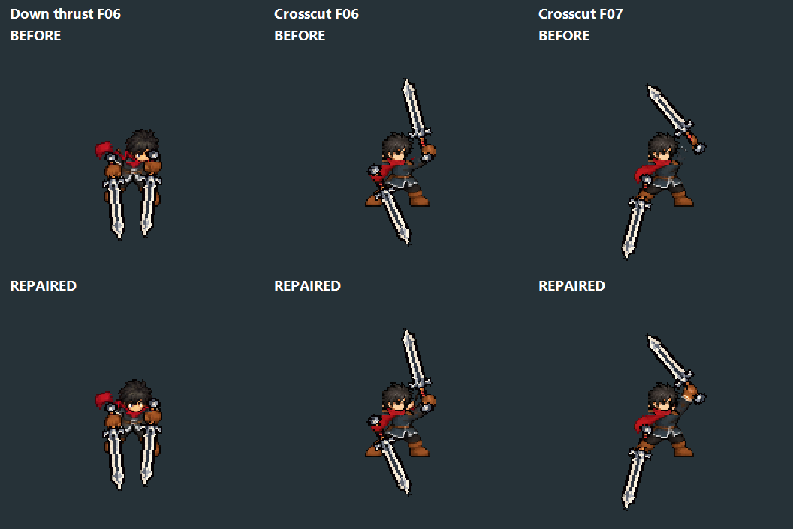
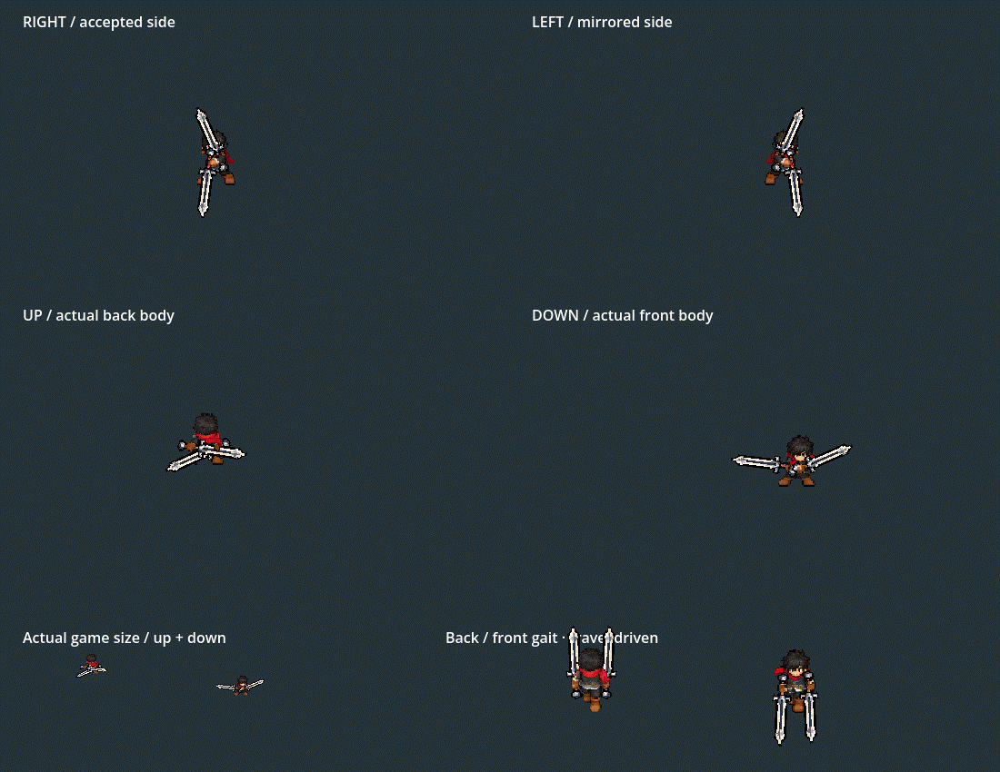

# Twinsteel marked attack frames — 2026-10-06

The owner identifies DOWN thrust F06/F07/F08/F09/F11-F13 head/scarf drift, side Crosscut F05-F07 detached raised arms and no fifth white slash in the drawing sheets.

Front-thrust ingestion now centers the existing native head on the drawn crown/neck axis instead of matching an asymmetric red pixel in the reference scarf. It keeps the original scarf and real fists, alpha-composites the native head and removes discarded scalp fragments. Only the DOWN thrust uses this replacement path; shared Greatsword helpers, accepted carry and gait remain unchanged.

The first side ingestion had erased neutral sleeve/outline pixels inside the old scalp bounds. Repair copies original raster arm pixels into missing space along the drawn raised arm, retaining the installed face and body pose. Calibration then registers both actual gloves and foreground masks. Existing queue copies propagate the corrected end poses into the next opening.

The fifth slash is present in the normal Player in all four directions. It was omitted from the earlier pose-only drawing export, along with every other swing effect, to expose anatomy. Its atlas and runtime presentation are unchanged.

The fifth preview is a19-frame excerpt from the105 native cardinal captures, not newly synthesized animation. Enlarged four directions and actual game-size up/down are shown. Real production Player evidence is separate: [right](gameplay/final_slash_right.png), [left](gameplay/final_slash_left.png), [up](gameplay/final_slash_up.png), [down](gameplay/final_slash_down.png).

Validation uses Godot4.7.2 Compatibility native rendering:

- Cardinal4586 checks/0 failures,105 captures: all cels/facings, original carry/stride/grip/face references, grounded soles, buffer endpoints, head-axis bounds and raised-glove connection into the torso. The isolated art fixture does not claim campaign integration.
- Actual Player232 checks/0 failures: F9/Tab acquisition/equipment, directional runs/attack inheritance, all five cuts, skills/dash/reaction restoration, swaps/snapshot compatibility and Stage I. During fifth contact, a frozen production pose is rendered with and without only its trail;830/right,827/left,739/up,850/down bright pixels independently confirm visibility. Test does not write runtime art or campaign saves.
-10 attack/endpoint PNG/TRES files change: DOWN descending and inherited rising opening, side rising and inherited scissors opening.56 other runtime files and all92 protected heavy/source files are byte-identical. All66 outputs rebuild identically; see scope_validation.json, before.json, after.json and rebuild_validation.json.
-260 updated native pose images are under drawings/frames, with original frame IDs, shared lossless crop and uniform nearest enlargement. They intentionally omit FX; drawings/manifest.json states this explicitly. Inspection images and the one-off diagnostic source are archived under inspection/.
- The19-frame fifth GIF decodes successfully. Its derived motion_timeline.json references the original cardinal/motion_frames images and retains their timing.

No new source art, runtime animation solver, combo timing, damage, reach, stepping or carry/gait changes. Accepted sketch-carry owner approval remains limited to that earlier scope; owner visual acceptance of this attack correction is pending.

Stop and rerun F5 to load current textures. Equip Twinsteel through F9 → Tab → Twinsteel → Equip; use the normal training launcher or F7 Combat Lab with Admin enabled. Left click attacks; Space dodges.
