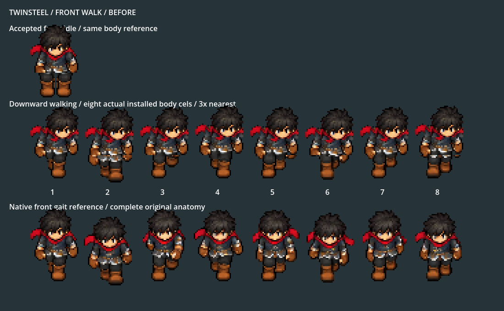
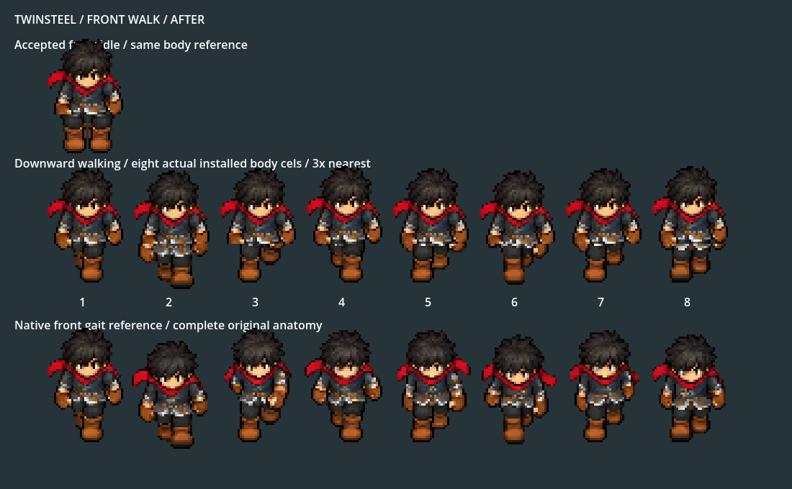
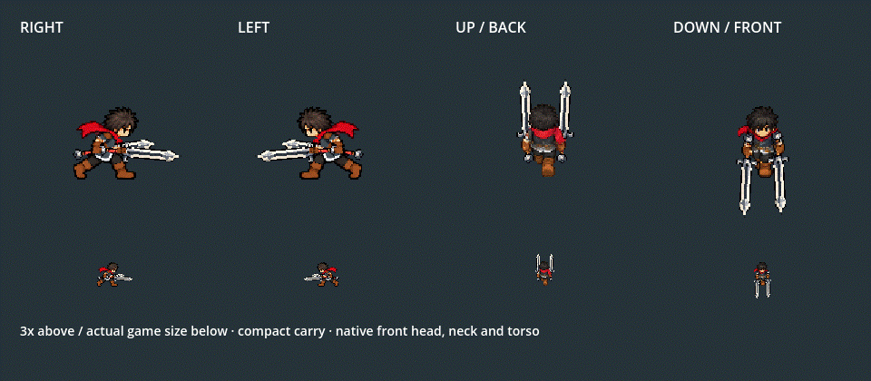

# Twinsteel downward walking anatomy

2026-10-06. Owner reports incorrect head/body while walking downward after normal-game installation. Native before-sheet and metadata show the walking head base at(89,41), versus accepted idle(84,41). Reapplying head attachment during cardinal run calibration displaced the already native head relative to the torso.

DOWN now uses one complete native front upper cel from `greatsword_cardinal/down/run.tres`, with the same sole registration as accepted front idle. Head, neck, scarf, chest, arms, both actual glove grips and masks share the tiny one-pixel bob. Original eight native leg keys remain below Y77; the head is never attached separately. Both16×62 blades retain the shallow3° tilt and actual glove attachments. Native render confirms front head/neck/torso alignment matches idle.

## Before and after

The middle row is the installed eight-key DOWN walking body; the top is accepted idle and the bottom is the unchanged original native gait. Three-times nearest rendering, without weapon overlap hiding the anatomy.







## Verification

| Evidence | Result |
| --- | --- |
| Cardinal art/presenter checks |4374 checks,0 failures; `motion/validation.json` |
| Actual Player, Bag, skills, dash, reactions and Stage I |210 checks,0 failures; `gameplay/validation.json` |
| Runtime art scope |3 DOWN run assets changed,62 identical; `scope_validation.json` |
| Protected heavy/source files |92 identical hashes |
| Repeat build |All65 PNG/TRES outputs identical; `rebuild_validation.json` |
| Native gait preview |48 frames, decoded/validated GIF |

New independent assertions compare the front walking head/neck/chest/gloves with the accepted native reference, verify exact head metadata and preserve each original leg cel below the pelvis seam. They supplement the older silhouette/grip/within-run consistency checks, which missed a consistently misplaced head. The comparison stays above the fixed pelvis seam when the upper body bobs; fixed legs are checked separately.

Only `assets/characters/playable/king/dual_twinsteel/down/run_body.png`, `down/run_hands.png` and `down/run.tres` change. Other views, idle, attack cels, blade, white FX and combat rules remain byte-identical. Native tests run on Godot4.7.2 Compatibility. The offline builder keeps its generated blade ImageTexture anonymous because the normal catalog already loads the output texture; its explicit resource writer emits the runtime path. This removes the cache-path warning from the initial build; final repeat build and native logs are clean.

## Test in game

Stop the running game and restart F5 → Sanctuary → F9 → Tab → Twinsteel · Dual Swords → Equip. Walk with S and compare against front idle. F7 opens actual Combat Lab after F9. User-owned running games/editor were left open; they need a fresh run to load the changed textures.

```powershell
& 'D:\WORK_APP\godot\Godot_v4.7-stable_win64_console.exe' --path . --rendering-method gl_compatibility --fixed-fps 60 --script res://tests/king_dual_twinsteel_cardinal_smoke.gd -- --output=res://art_source/review/combat/king_dual_front_gait_2026_10_06/motion/
& 'D:\WORK_APP\godot\Godot_v4.7-stable_win64_console.exe' --path . --rendering-method gl_compatibility --fixed-fps 60 --script res://tests/king_twinsteel_gameplay_smoke.gd -- --output=res://art_source/review/combat/king_dual_front_gait_2026_10_06/gameplay/
```

Source/build provenance stays in `art_source/generated/characters/king/dual_unified_2026_10_05/`. Passing checks establish the stated anatomy/paths, while owner visual acceptance, comparative balance and phone profiling remain open.
