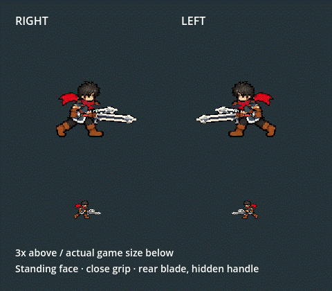

# Twinsteel side-running face and handle correction

2026-10-06. The owner accepts the preceding UP feet correction, then reports the two side-running views: the face differs from standing King, and the exposed rear handle looks detached. The request explicitly keeps the far sword blade while hiding its handle.

Side run now registers the independently accepted `greatsword_confidence_v2/idle.tres` head/face to the actual run scarf socket, at(91,41,25,24). Torso, fists(87,75)/(105,75), shared whole-pixel bob and all eight native leg keys remain. Both grips still use(8,44). The far primary sword paints behind the body using a16x62 canonical blade variant: rows0..42 are identical to the full sword, rows43..61 are transparent. The near offhand keeps its complete sword; its guard is3 logical pixels/1.5worldpx from the actual drawn fist. UP/DOWN, idle and attack art remain unchanged.

Authored attack entry inherits each actual texture along with its rig/local offset/depth. The full attack texture returns at the next authored cel. This prevents the hidden rear handle flashing on the first run-to-attack frame, without another clock or contact rule.

[Before native composition](before_gait/motion_frames/frame_000.png), [after native composition](gait/motion_frames/frame_000.png), [all eight body cels and identity references](anatomy/after.png), [original owner report](owner_report.png). The comparison and animation use native Godot4.7.2 Compatibility rendering, fixed60fps. The GIF has48 decoded frames and nearest sampling, showing3x above and actual0.5 scale below.

Validation:

- Native cardinal4430 checks/0 failures: approved standing face/neck, coherent eight-key upper/grip bob, native legs, hidden far handle, preserved canonical blade/guard, near glove attachment and depth, all directional clips and buffered chains, previous UP/DOWN corrections.
- Actual normal Player218/0: both mirrored side-run textures, no entry flash or registration jump, full blade restoration at contact, all four directional runs/five cuts, Bag/F9, all five skills, dash/hit recovery, weapon swaps, inventory snapshots and Stage I.
- Axe/Greatsword regression2771/0 after the shared presenter correction.
- Scope: only existing side `run_body.png` and `run.tres` change; `twinsteel_side_rear.png` is added. The other63 previous runtime outputs and all92 protected heavy/source files remain byte-identical. `scope_validation.json` records the exact paths.
- All66 runtime PNG/TRES outputs reproduce identically in a second full build; `rebuild_validation.json` records zero mismatches. Source provenance/current hashes are refreshed in `art_source/generated/characters/king/dual_unified_2026_10_05/`.

Headless is used for the offline builder/import, not as a visual proof. Technical checks do not establish owner visual acceptance of this new side correction; that review remains open. The earlier UP correction is owner accepted.

To test, stop and rerun F5, press F9 for the session-only kit, then Tab Bag -> Twinsteel -> Equip. A/D run; left click attacks; Space dodges. With Admin enabled by F9, F7 opens the actual Combat Lab. The existing `tools/launch_king_twinsteel_training.ps1` also opens real training with Twinsteel equipped. No commits, pushes or real-save mutations were made.
