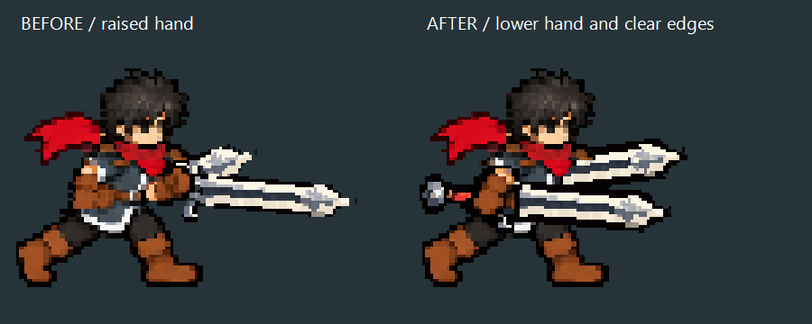
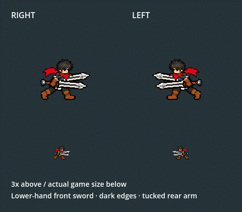

# Twinsteel — owner-sketch placement and readable edges

2026-10-06. The owner rejected the previous raised-hand chest/palm carry, supplied a yellow sword outline, then explained that merged pixels and weak edges made the anatomy hard to understand. The preceding pass had reversed the near/far hand assignment: the long front sword belonged in the lower hand beside the hip.

The complete primary sword now registers to the actual lower near palm, native(84,73) translated(+3,+1) to(87,74). Its intact forearm and fingers paint above that handle. The other arm/grip(91,69) stays behind the vest, with its handle transparent and its blade projecting. Side angles+5/-8 keep the pair close and distinct. The accepted face and central chest remain native; the real foreground arm is composed after the original legs so the Y77 seam cannot slice it.

The canonical16x62 steel and near forearm receive one additional charcoal perimeter texel from the native palette. This is offline pixel work, with no runtime shader or per-frame correction. Canonical steel shares the stronger edges in idle, running and attacks. Every build starts from immutable inputs, preventing cumulative thickening or shrinkage. The far blade variant derives from that same outlined canonical image.

[Owner sketch](owner_sketch.png), [before native view](before.png), [after native view](gait/motion_frames/frame_000.png), [actual Combat Lab right run](gameplay/training_run_right.png), [actual left run](gameplay/training_run_left.png), [Stage I](gameplay/stage_1_equipped.png).

Validation uses Godot4.7.2 native Compatibility rendering:

- Cardinal4567 checks/0 failures, including105 captures. Independent accepted face, native central vest and source glove pixels; actual lower-hand depth/mask, occluded rear grip, intact forearm below the pelvis seam, coherent bob, original leg pixels outside the real foreground arm; all facings, five cuts, queue continuity and blade interpolation. Its campaign_integrated=false field describes the isolated art fixture, not normal installation.
- Actual Player220/0: F9/Tab Bag and paper doll, mirrored side runs and attack entry, both texture/offset inheritances and complete attack restoration, four directional five-cut chains, skills1–5, dash/damage recovery, swapping, inventory compatibility and Stage I. Six gameplay captures are retained. art_modified_by_test=false means the test does not write runtime art.
- Five outputs change: side run_body.png, run_hands.png, run.tres, twinsteel.png and twinsteel_side_rear.png. The other61 outputs and all92 protected heavy/source files remain byte-identical. There are no new runtime assets. Full66-output rebuild is identical; scope_validation.json, before/after.json and rebuild_validation.json record hashes.
- The48-frame gait GIF decode-checks. Headless is used only for offline build/import, not animation or gameplay judgement. Native code, generation manifest, registration and current project handoff are updated; obsolete bent-arm code is removed.

Restart F5 → F9 → Tab → Twinsteel · Dual Swords → Equip. Test A/D walking and left-click attacks; F7 opens the real Combat Lab while Admin Mode is enabled. The real training launcher remains tools/launch_king_twinsteel_training.ps1. No real-save mutations, commits or pushes.

Owner explicitly accepted this carry/outline correction on2026-10-06 after reviewing the latest result. This is now the approved carry baseline; preserve its proportions, native face, lower-hand grip, tucked rear arm and dark edges for future variants. Passing technical checks did not make the preceding geometry acceptable; that proof is historical and rejected. Accepted UP/DOWN anatomy and attack cels, white FX, range, timing and damage are unchanged. Stronger canonical blade edges intentionally appear in every Twinsteel state. Campaign acquisition, comparative balance and device profiling remain separate work.
