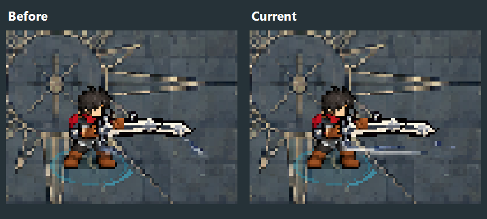
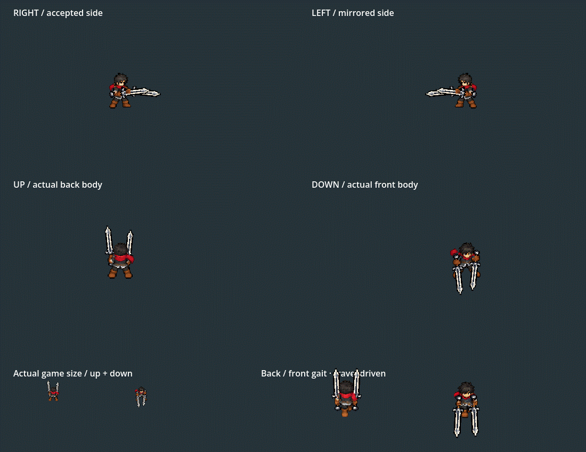

# Twinsteel first-hit white wave — 2026-10-06

The owner reports that the first basic attack appears to have no white wave. This differs from the earlier fifth-slash question: the first effect was present in its atlas but mostly absent in actual playback.

The first contact is a narrow72px paired thrust. Its old wide curved raster effect was clipped down to faint blue/white fragments, producing only6-7 independently measured bright pixels in the real Player. The new registration compacts the same four original effect cels into one160x16 forward-wave band centered(112,102). Nearest sampling and shared registration across ignition/contact/fade preserve the original raster palette and phase order. No new source generation or runtime drawing code is added.

The11-frame native excerpt references cardinal/motion_frames through preview/motion_timeline.json. It retains original motion timing, with a450ms final preview hold. Actual game-size up/down are shown below the enlarged four cardinal views.

Validation:

- Before correction: real Player244 checks/4 failures, confined to the first-contact visibility assertions:7/right,7/left,6/up,7/down bright pixels. Fifth visibility remains830/827/739/850.
- After correction: real Player244/0. A frozen production pose rendered with/without only its trail measures34/right,32/left,38/up,31/down bright first-wave pixels. Fifth counts remain exactly830/827/739/850. Normal Bag, directional chains, skill/dash/reaction restoration, swaps, inventory compatibility and Stage I also pass.
- Native cardinal4586/0 with105 captures: accepted face/body/carry/stride/grip references, all attack cels, continuation, sole plane and source anatomy checks remain valid.
- Only assets/characters/playable/king/dual_twinsteel/swing.png changes. All pixels outside its first192px row are identical,65 other PNG/TRES outputs match and92 protected heavy/source files match.66 outputs remain identical after repeat FX build. See scope_validation.json, before.json, after.json and rebuild_validation.json.
- The11-frame GIF decodes successfully. visibility_validation.json records source/builder hashes and current registration; gameplay.log and cardinal.log retain the native results. Headless is used only for offline generation/import.

The narrow contact shape, timing0.12/0.12/0.14s, damage, reach, audio, combo motion, accepted carry/gaits and preceding head/sleeve repairs are unchanged. The wave is a presentation of the existing melee contact; it does not create a projectile or new damage tick. Owner visual judgement remains open.

To rebuild the FX atlas: Godot --headless --path . --script res://tools/build_king_dual_polish_fx.gd, then reimport. Body assets continue to use build_king_dual_unified.gd. Runtime never loads the source/review folders.

Stop and restart F5 to load the atlas. F9 → Tab → Twinsteel → Equip; left click attacks. Normal Combat Lab/training and Stage I use the same presentation.
