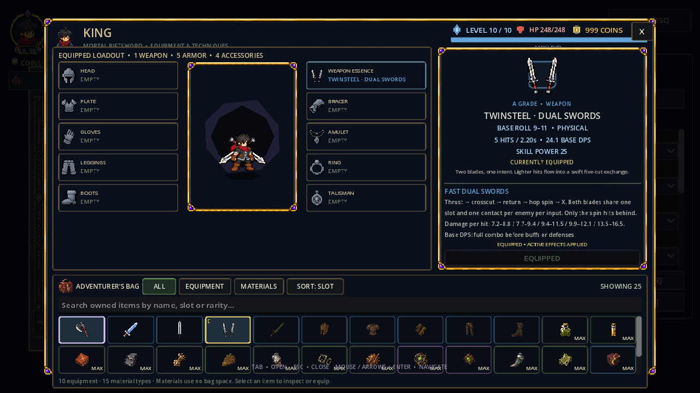
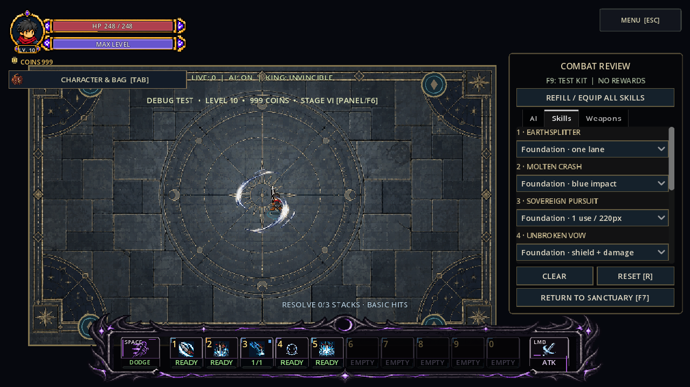
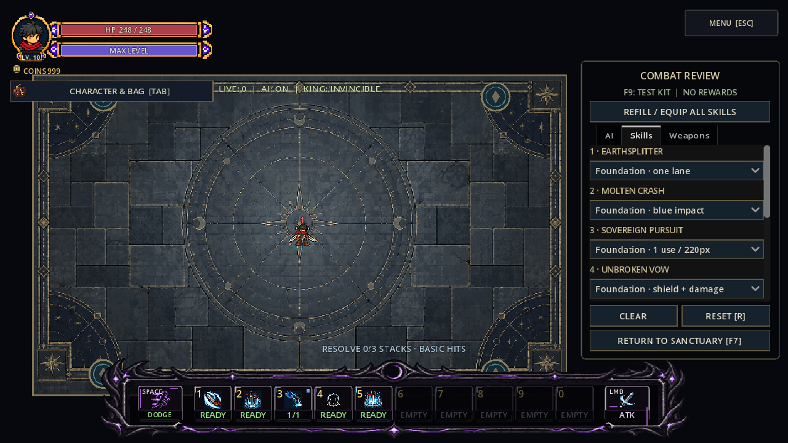
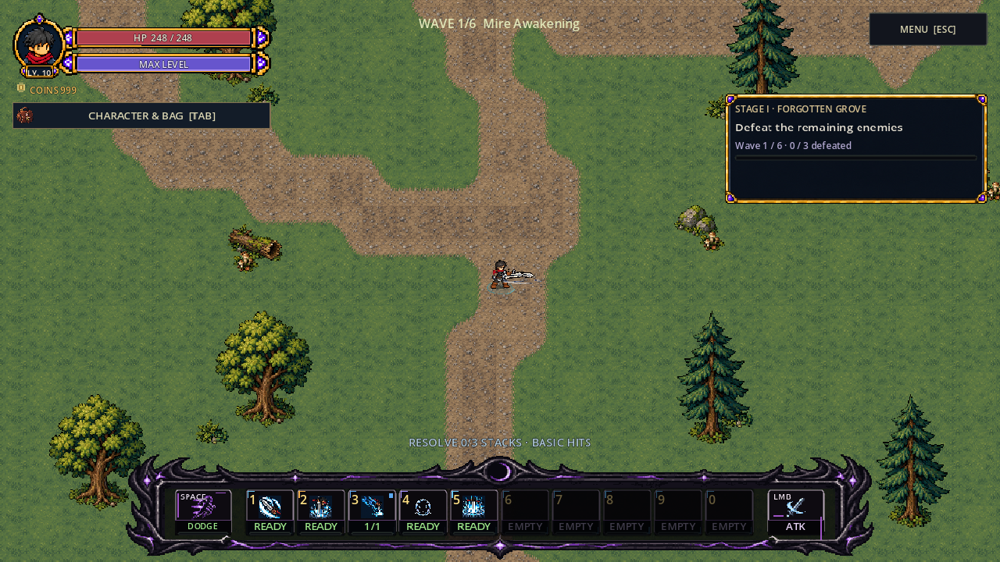

# Twinsteel in normal gameplay and training

Completed2026-10-06 on Godot4.7.2.stable.official.ed1daf0bf, native Compatibility rendering. The folder retains its2026-10-05 task-start date. Owner passes the compact pair and final closer side hilts, then requests actual training/game installation. Approved art and heavy-family files are unchanged.

## Play

Run `tools/launch_king_twinsteel_training.ps1` for the real Combat Lab with Twinsteel equipped, a paused Rootling, visible ordinary Bag and session-only test gear. Or restart F5 → Sanctuary → F9 → Tab → Twinsteel · Dual Swords → EQUIP ITEM → close Bag; F7 opens Combat Lab with Admin Mode enabled. F9 suppresses campaign autosaving; campaign crafting/acquisition is not yet authored.

Normal controls: WASD move, left click attack/buffer, Space dash,1–5 skills, Tab Bag. The old isolated motion fixture remains available but has different Space/Tab controls.

## Native validation

| Check | Result | Evidence |
| --- | --- | --- |
| Normal Player / equipment / Stage I |210 checks,0 failures| `validation.json`, `gameplay.log` |
| Cardinal paired art/presenter regression |4350 checks,0 failures| `art_regression/validation.json`, `art_regression.log` |
| Existing axe and Greatsword |2771 checks,0 failures| `greatsword_regression/validation.json`, `greatsword_regression.log` |
| Approved Twinsteel PNG/TRES files |65 identical hashes| `art_before.json`, `scope_validation.json` |
| Protected heavy/source files |92 identical hashes| `scope_validation.json` |

The gameplay test exercises physical F9 and Tab, catalog acquisition, ordinary Bag equip/paired paper doll, actual four-direction travel-driven gait and five buffered cuts, side-run grip inheritance into attack, upward white-effect depth, one contact per enemy/input, rear spin only, out-of-range rejection, all five skill input/confirmation/cancel paths, dash, accepted-damage flinch and natural recovery, family/signature switching without duplicated body nodes, inventory snapshot round-trip, old snapshot compatibility and a real Stage I Player attack after scene handoff. Test storage/autosaves are isolated from campaign progress.

The art test is deliberately still an isolated art fixture and reports `campaign_integrated=false` for its own controller. Actual game installation is proven by `validation.json` and the new gameplay test. Its4350 assertions omit105 optional capture checks present in the earlier4455 art pass.

The production pair references the existing shared combo/profile under `data/weapons/families/twinsteel_prototype/`; it does not equip the isolated prototype WeaponDefinition. Existing skill/dash/reaction cels remain the fallback. Comparative balance, bespoke family action cels, campaign acquisition and phone profiling remain open.

## Captures









## Reproduce

```powershell
& 'D:\WORK_APP\godot\Godot_v4.7-stable_win64_console.exe' --path . --rendering-method gl_compatibility --fixed-fps 60 --script res://tests/king_twinsteel_gameplay_smoke.gd
& 'D:\WORK_APP\godot\Godot_v4.7-stable_win64_console.exe' --path . --rendering-method gl_compatibility --fixed-fps 60 --script res://tests/king_dual_twinsteel_cardinal_smoke.gd -- --output=res://art_source/review/combat/king_twinsteel_gameplay_2026_10_05/art_regression/
& 'D:\WORK_APP\godot\Godot_v4.7-stable_win64_console.exe' --path . --rendering-method gl_compatibility --fixed-fps 60 --script res://tests/king_oathbound_greatsword_smoke.gd -- --output=res://art_source/review/combat/king_twinsteel_gameplay_2026_10_05/greatsword_regression/
```

Run native tests sequentially. The game has not been exported or profiled on a phone in this pass. Automated checks establish the stated paths, rather than final balance or player feel. Art generation/rebuild provenance remains under `art_source/generated/characters/king/dual_unified_2026_10_05/`; accepted motion previews remain in `king_dual_close_hilt_2026_10_05/`.
