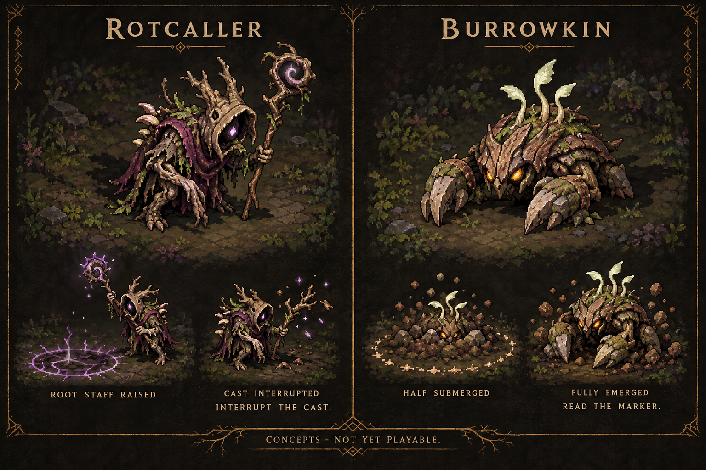

# Fresh forest enemy mechanics

2026-10-03. Requested alongside the expedition refactor. **Rotcaller is now playable in a dedicated no-save trial (Decision170); campaign roster insertion, Hunt rewards and Burrowkin remain planned.** The separate Stage III14/5 pressure comparison remains review-only. See [trial rules, controls and verification](stage-4-eastern-rot-and-rotcaller-trial.md). The board below remains illustrative concept art.

## Strongest next playable slice: Rotcaller

A small root-priest support enemy makes the player choose whom to attack. It plants one clearly warned root zone at the player's snapshotted position. Hitting the caster during preparation cancels the cast and exposes a recovery window. The player can interrupt or leave the marked area; neither choice requires buying a particular skill. This is deliberately different from the current Rootling's locked lane, Bramble Spitter's destructible projectile and Husk's multi-lane eruption.

Provisional prototype numbers, not accepted balance:

| Property | First test |
|---|---|
| Placement | One optional Stage IV Hunt/test encounter; then consider a limited mixed wave |
| Live cap | Rotcaller occupies an ordinary encounter slot; initially only one per encounter |
| Cast |1.1s staff-rise warning; zone stops following King when the warning begins |
| Zone |32px radius, one .35s eruption; at most one pending zone per caster |
| Counter | Any accepted player damage interrupts the active preparation; no immunity to basic attacks |
| Recovery | .8s exposed after an interrupted cast; no instant recast |
| Cadence | At least5s between preparations; no ally summoning or healing |
| Starting tuning |55HP, one10-damage contact; tune against minimum route-eligible King |

An interrupted/dead caster removes the pending zone. The eruption is a single damage contact, not a frame-driven damage/slow stack. A paused menu freezes preparation/damage; resumes never burst queued casts. Snapshots must fall on reachable ground and outside solid footprints/chest/portal/service spaces. Test with exactly one caster plus two Rootlings first, then a Spitter. Preserve existing Stage III solo-boss story.

Art acceptance requires real idle, directional walk, staff-rise, held warning, release, interruption/recovery, hurt and death drawings. Use explicit facing/origin/native40px-ish silhouette, not an idle sprite gliding around. Authority owns the state/cast/zone; presentation observes it for animation/ring/sound. Add a generic EncounterSpawnEntryDefinition rather than a new legacy rootling-style count field. Telegraph shape/timing must remain legible at native960x540 and distinguish itself from decorative violet runes.

## Follow-up: Burrowkin

A low root-and-stone crawler changes positioning. It sinks briefly, chooses a reachable destination, displays a dust ring at that fixed emergence point for .9s, emerges with one short attack and stays exposed for .8s. The marker remains visible while underground; no invisible chasing, teleport contact damage or emergence inside obstacles. A failed destination search cancels the attempt into recovery. Prototype two ground crawlers separately before mixing one with a ranged enemy; keep the normal cap and avoid simultaneous burrows until readability is proven.

Burrowkin should have real dive, underground marker, emergence and recovery art. It is **not** a new invulnerable swarm or a reskin of Mireling's leap. Numerical health/damage/intervals remain to be authored in the first prototype, after the warning/recovery interaction works.

## More enemies and other fresh features

Increase pressure in deliberate steps. Stage II already permits six active and Stage IV eight; the campaign does not use one universal four-enemy cap. Do not increase every stage at once. Stage III's optional14 total/five-live approach is a bounded experiment; its normal10/four and solo Husk remain. Start by adding one role into an existing slot, then evaluate whether one additional live slot improves area-skill use without hiding attacks.

After the first new enemy works, use the approved **Hunts** to expose a variant with visible conditions and known crafting-material rewards. A simple objective could be “interrupt two Rotcaller casts and clear the encounter”; authority records actual successful interrupts, reward is granted once through the Hunt completion contract, and retries never award infinite partial rewards. This remains a proposal until Hunt selection/receipt/save authority is implemented.

Add the planned inspectable lore marker and finite side cache before random breakables. Breakables must release collision/navigation on destruction through an event, use an explicit authored reward budget and persist relevant completion. Keep the field scout outside active attack lanes, with real directional walk frames and briefings that explain the new counterplay. None of these are considered finished by documenting them here.

## Implementation order and exit criteria

1. Stage IV environment/audio and an isolated Rotcaller combat trial are implemented under Decision170. Continue owner review and V/VI renewal.
2. Review the generated directional/action drawings and provisional tuning in the dedicated trial; they are not accepted campaign balance.
3. Pause, death/defeated-target cancellation, real basic-attack interruption, solid/navigation placement, one-contact damage, wave-slot accounting and native controls pass. Minimum-gear feel and service-space placement remain to review before campaign insertion.
4. Integrate one limited mixed encounter, then the optional Hunt/receipt/save contract.
5. Add Burrowkin after the first new role is readable and measured.

Owner concept/difficulty review and minimum-gear combat are required before promoting a proposal to campaign balance. The generated board is illustrative concept art, not an animation sheet or evidence of a playable mechanic.
